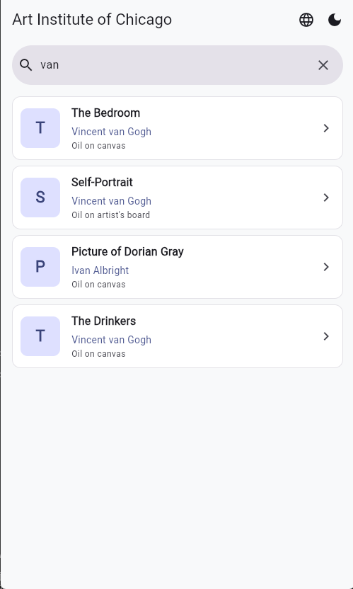
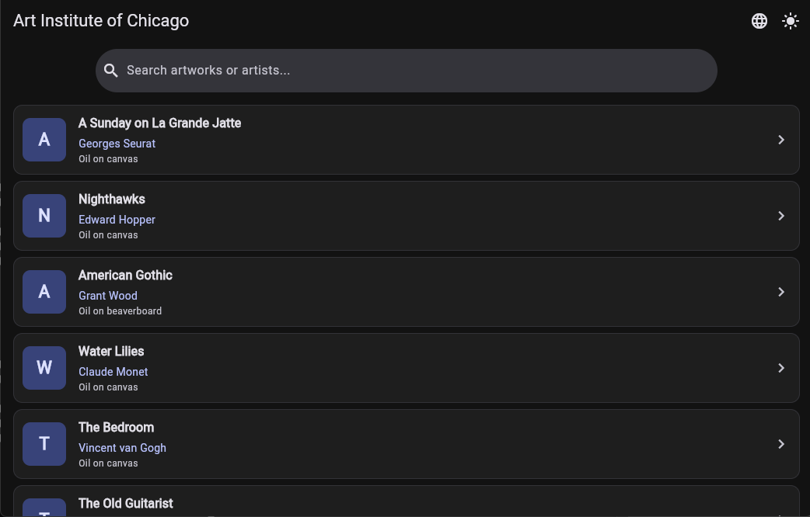
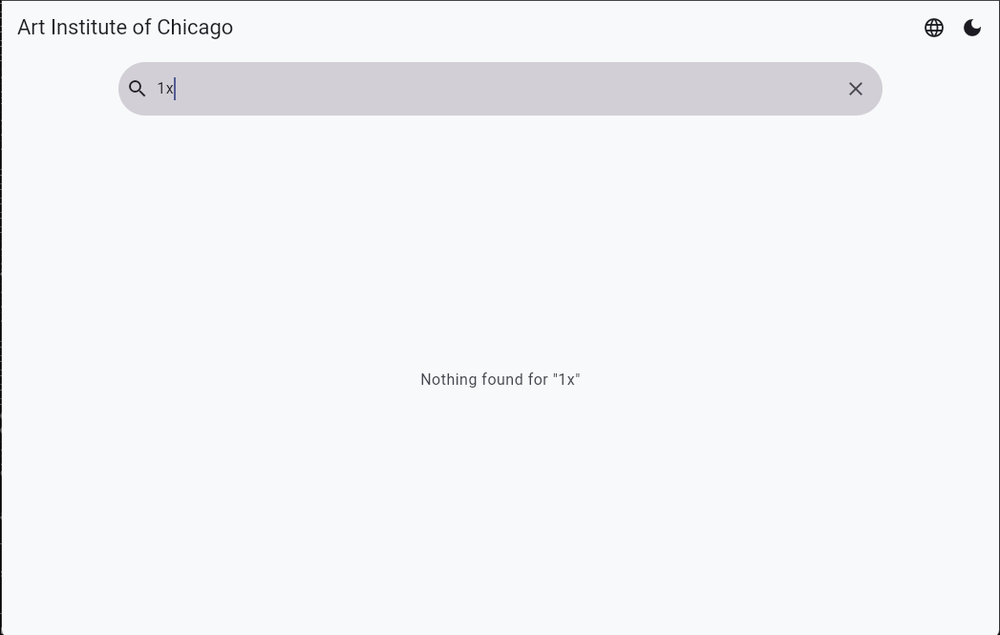
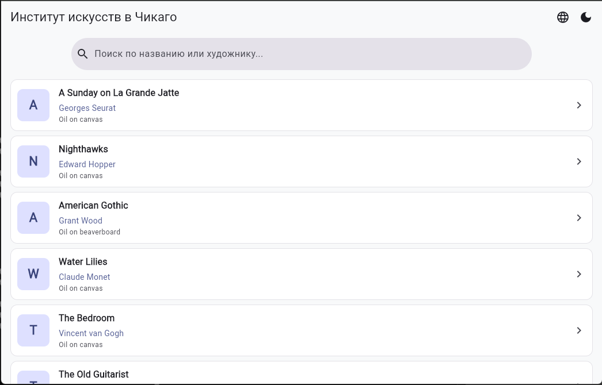
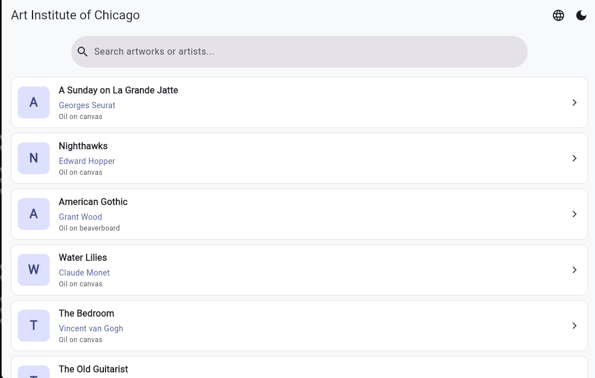
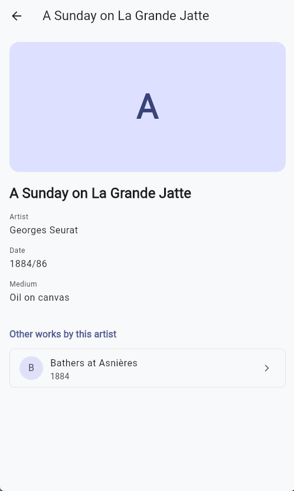
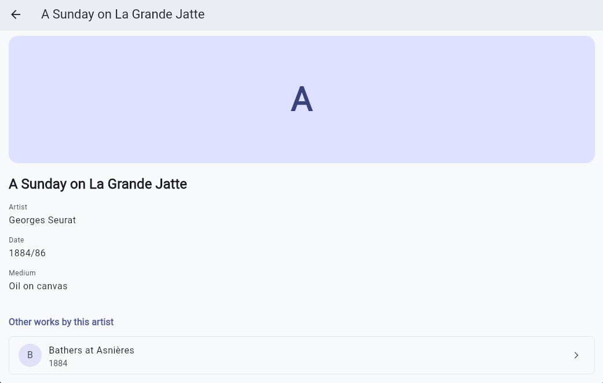

# Каталог экспонатов Института искусств в Чикаго 

Учебное кроссплатформенное приложение на Flutter

##  Запуск проекта

### 1. Клонирование репозитория и установка зависимостей:
```bash
git clone https://github.com/PolinaSedikova/chicago_art_catalog.git
cd chicago_art_catalog
flutter pub get
```

### 2. Запуск в браузере (Таргет 1):
```bash
flutter run -d chrome
```

### 3. Запуск на Windows Desktop (Таргет 2):
```bash
flutter run -d windows
```

##  Скриншоты






